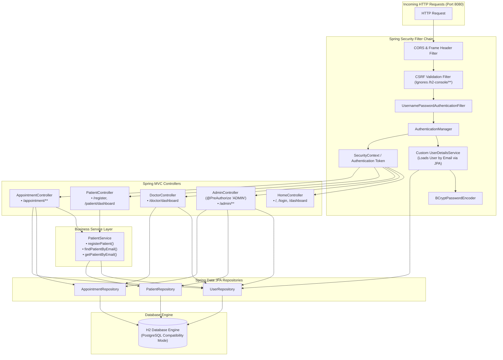
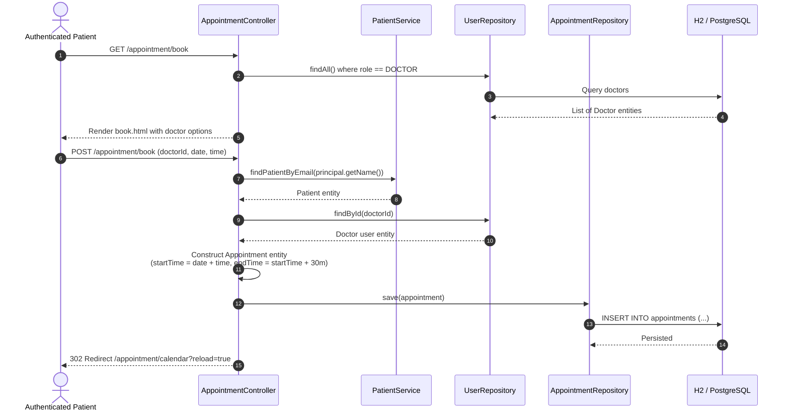

# ⚙️ Backend Tier Workflow Specification

This document outlines the architecture, component interactions, request lifecycles, and security pipelines for the backend tier of **CareSoft Health Bridge: UNESCO Global Health Logistics**.

---

## 1. Architectural Architecture & Component Stack

The backend application is designed following clean layered architecture:



---

## 2. Security Pipeline & Request Lifecycle

### 2.1 Filter Chain Routing Rules
The security configuration in [`SecurityConfig.java`](file:///D:/PROJECT_S/Spring%20Boot%20HMS/hospital-management-springboot/src/main/java/com/hms/hospital/config/SecurityConfig.java) defines strict role-based access controls:

| Path Pattern | HTTP Method | Permitted Authority | Action / Behavior |
| :--- | :--- | :--- | :--- |
| `/`, `/login`, `/register` | GET, POST | `permitAll()` | Public landing, login, and registration |
| `/css/**`, `/js/**`, `/swagger-ui/**`, `/v3/api-docs/**` | GET | `permitAll()` | Static assets and OpenAPI documentation |
| `/h2-console/**` | ALL | `permitAll()` (with CSRF ignored & frameOptions sameOrigin) | Internal developer database console |
| `/admin/**` | ALL | `hasRole('ADMIN')` | Administrative access only |
| `/doctor/**` | ALL | `hasRole('DOCTOR')` | Doctor operations |
| `/appointment/**`, `/patient/**` | ALL | `authenticated()` | Authenticated patients, doctors, or admins |

### 2.2 Role-Based Smart Router (`/dashboard`)
When a user authenticates successfully, Spring Security forwards the session to `/dashboard`. The `HomeController` extracts the granted authority and executes dynamic role routing:

```java
String role = authentication.getAuthorities().iterator().next().getAuthority();

if (role.equals("ROLE_ADMIN")) {
    return "redirect:/admin/dashboard";
}
if (role.equals("ROLE_DOCTOR")) {
    return "redirect:/doctor/dashboard";
}
return "redirect:/patient/dashboard";
```

---

## 3. End-to-End Business Logic Sequences

### 3.1 Appointment Booking Sequence



### 3.2 Asynchronous Calendar Event Dispatching
To prevent infinite JSON recursion and format dates for FullCalendar.js:
1. Client requests `GET /appointment/events` or `GET /appointment/doctor/events`.
2. Controller retrieves current `Principal.getName()`.
3. Resolves user role:
   - **PATIENT**: Queries `appointmentRepo.findByPatientUserIdOrderByStartTimeAsc(userId)`.
   - **DOCTOR**: Queries `appointmentRepo.findByDoctorIdOrderByStartTimeAsc(doctorId)`.
   - **ADMIN**: Queries `appointmentRepo.findAll()`.
4. Maps records into a decoupled DTO list:
   - `id`: Unique record ID
   - `title`: Appointment checkup title
   - `start` & `startTime`: ISO-8601 string (`yyyy-MM-ddTHH:mm:ss`)
   - `end` & `endTime`: ISO-8601 string (`yyyy-MM-ddTHH:mm:ss`)
   - `status`: Booking status (`SCHEDULED`, `COMPLETED`, `CANCELLED`)
   - `patientName`: Extracted patient display name

---

## 4. Automatic Data Initialization & Bootstrapping

Upon application boot, [`DataInitializer.java`](file:///D:/PROJECT_S/Spring%20Boot%20HMS/hospital-management-springboot/src/main/java/com/hms/hospital/config/DataInitializer.java) implements `CommandLineRunner` to guarantee seamless out-of-the-box readiness:

1. **Admin Seed**:
   Checks for `admin@hospital.com`. If missing, creates account with hashed password (`password`) and role `ADMIN`.
2. **Doctor Seed**:
   Checks for `sarah@hospital.com`. If missing, creates account with hashed password (`password`) and role `DOCTOR`.
3. **Patient Seed**:
   Checks for `patient@hospital.com`. If missing, creates user and associated `Patient` profile with generated identifier `PAT-0001`.
4. **Appointment Seed**:
   Inserts initial sample appointments to populate dashboard agendas and calendar displays immediately on startup.
