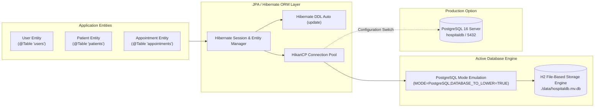
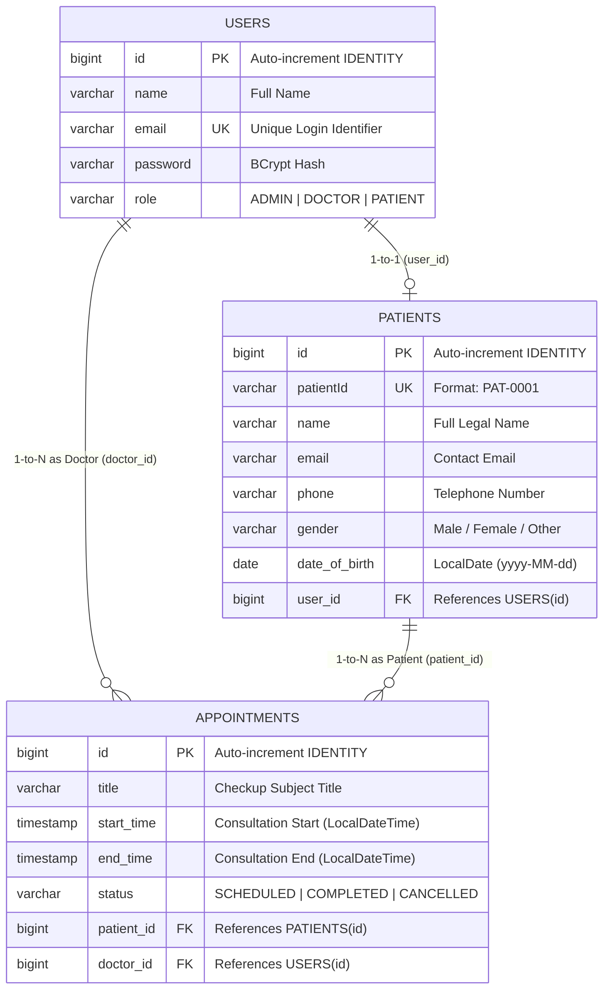

# 🗄️ Database Tier Workflow Specification

This document details the database architecture, entity-relationship model, schema design, constraints, and persistence lifecycle for **CareSoft Health Bridge: UNESCO Global Health Logistics**.

---

## 1. Persistence Architecture

The persistence layer uses **Spring Data JPA** with **Hibernate 7 / ORM**. The data storage is configured for high reliability, zero configuration overhead, and multi-environment compatibility.



---

## 2. Entity-Relationship (ER) Diagram



---

## 3. Detailed Schema Specifications

### 3.1 `users` Table
Stores all system accounts across all access roles.
* `id` (`BIGINT`, Primary Key, `GENERATED BY DEFAULT AS IDENTITY`)
* `name` (`VARCHAR(255)`): User's formal display name.
* `email` (`VARCHAR(255)`, Unique, Not Null): Login email used by Spring Security `UserDetailsService`.
* `password` (`VARCHAR(255)`, Not Null): 60-character BCrypt hashed representation.
* `role` (`VARCHAR(50)`, Enum `EnumType.STRING`):
  - `ADMIN`: Global administration and record management.
  - `DOCTOR`: Medical schedule management and patient reviews.
  - `PATIENT`: Appointment booking and health history.

### 3.2 `patients` Table
Contains healthcare demographics and is linked to the base `users` record.
* `id` (`BIGINT`, Primary Key, `GENERATED BY DEFAULT AS IDENTITY`)
* `patient_id` (`VARCHAR(50)`): Human-readable ID generated sequentially (e.g., `PAT-0001`, `PAT-0002`).
* `name` (`VARCHAR(255)`): Legal name of patient.
* `email` (`VARCHAR(255)`): Notification and confirmation email.
* `phone` (`VARCHAR(50)`): Mobile or emergency contact number.
* `gender` (`VARCHAR(20)`): Gender identity.
* `date_of_birth` (`DATE`): Date of birth mapped to `java.time.LocalDate`.
* `user_id` (`BIGINT`, Foreign Key): Links directly to `users(id)`.

### 3.3 `appointments` Table
Stores all medical consultation bookings between doctors and patients.
* `id` (`BIGINT`, Primary Key, `GENERATED BY DEFAULT AS IDENTITY`)
* `title` (`VARCHAR(255)`): Summary title (e.g. `Checkup - John Doe`).
* `start_time` (`TIMESTAMP`): Start timestamp mapped to `java.time.LocalDateTime`.
* `end_time` (`TIMESTAMP`): End timestamp (defaults to `start_time + 30 minutes`).
* `status` (`VARCHAR(50)`): Status flag with default `"SCHEDULED"`.
* `patient_id` (`BIGINT`, Foreign Key): Associated `patients(id)`.
* `doctor_id` (`BIGINT`, Foreign Key): Associated `users(id)` where `role = DOCTOR`.

---

## 4. Relationship Lifecycles & Cascades

### 4.1 User to Patient (`@OneToOne`)
```java
@OneToOne(mappedBy = "user", cascade = CascadeType.ALL, orphanRemoval = true)
private Patient patient;
```
- **Cascade Behavior**: Creating or deleting a patient user cascades automatically to the corresponding demographic record. If an administrative user removes a patient account, orphan removal ensures no orphaned medical profile remains.

### 4.2 Appointments Relationships (`@ManyToOne`)
```java
@ManyToOne
private Patient patient;

@ManyToOne
private User doctor;
```
- **Fetch Type**: Standard JPA default (`EAGER` / join fetch).
- **Referential Integrity**: Deleting an appointment does not delete either the patient or the attending doctor.

---

## 5. Query Optimization & Indexing Best Practices

### 5.1 Date Range Queries vs Function Calls
In earlier iterations, querying daily appointments used `@Query("... WHERE DATE(a.startTime) = :today")`. In SQL, wrapping a column in a function (`DATE(...)`) creates two issues:
1. **Engine Incompatibility**: H2 and older PostgreSQL versions fail if custom date functions are not explicitly registered.
2. **Table Scans**: Applying a function on indexed columns invalidates index usage, forcing a full table scan.

**Optimized Solution**:
Using standard Spring Data JPA range queries:
```java
List<Appointment> findByDoctorIdAndStartTimeBetween(Long doctorId, LocalDateTime start, LocalDateTime end);

default List<Appointment> findByDoctorIdAndStartDate(Long doctorId, LocalDate today) {
    return findByDoctorIdAndStartTimeBetween(
        doctorId, 
        today.atStartOfDay(), 
        today.atTime(23, 59, 59, 999999999)
    );
}
```
This enables the database engine to perform an efficient B-Tree index seek on `start_time`.

---

## 6. Migration Between H2 and PostgreSQL

The codebase is engineered to switch between lightweight local file storage and enterprise PostgreSQL without any code changes:

### Active Embedded Mode (`application.properties`)
```properties
spring.datasource.url=jdbc:h2:file:./data/hospitaldb;DB_CLOSE_DELAY=-1;DB_CLOSE_ON_EXIT=FALSE;MODE=PostgreSQL;DATABASE_TO_LOWER=TRUE;DEFAULT_NULL_ORDERING=HIGH
spring.datasource.driverClassName=org.h2.Driver
spring.datasource.username=sa
spring.datasource.password=
```

### Standalone PostgreSQL Mode
```properties
spring.datasource.url=jdbc:postgresql://localhost:5432/hospitaldb
spring.datasource.username=postgres
spring.datasource.password=your_password
spring.datasource.driver-class-name=org.postgresql.Driver
```
Both modes leverage the identical Hibernate JPA entities, schema generators, and repository queries.
