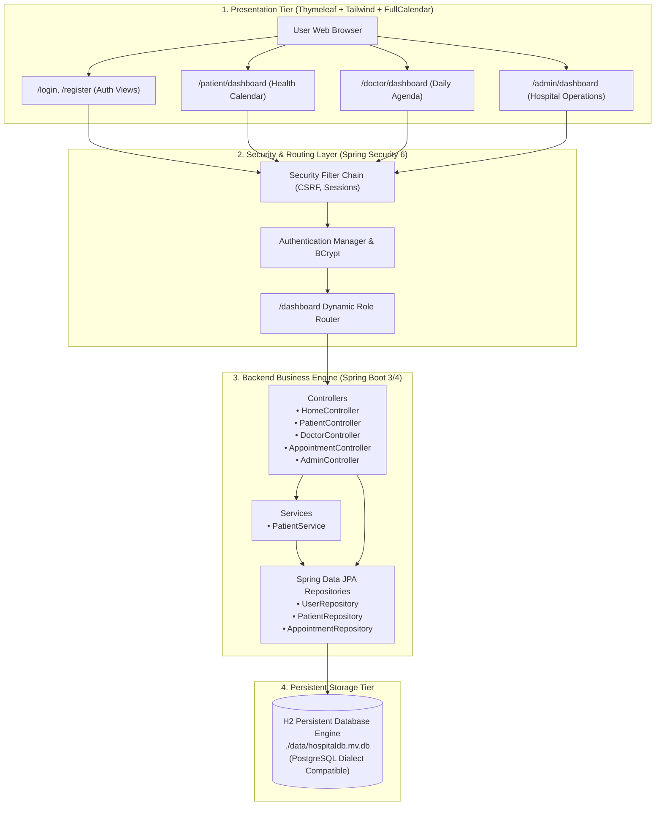
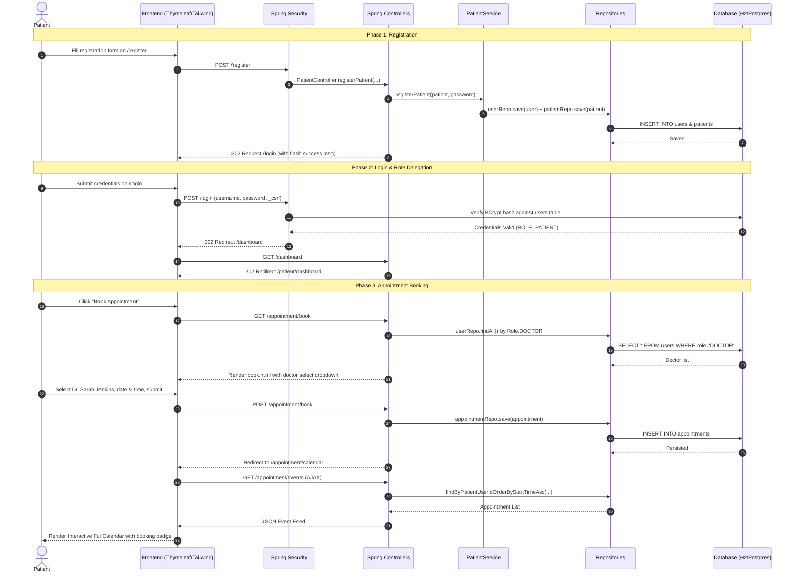
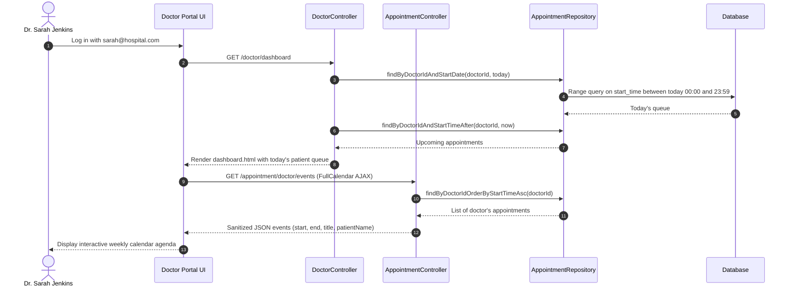
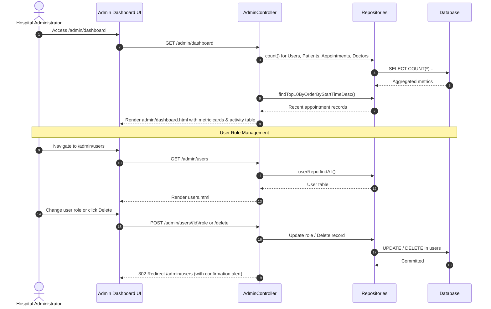

# 🔄 End-to-End System Architecture & Workflow

This document provides a holistic blueprint of how the **Frontend Tier**, **Backend Tier**, and **Database Tier** coordinate in **CareSoft Health Bridge: UNESCO Global Health Logistics**.

---

## 1. System Topology & Tier Architecture

---

## 2. Core End-to-End Sequence Workflows

### 2.1 Complete Patient Lifecycle (Registration to Appointment)

---

### 2.2 Doctor Daily Workflow

---

### 2.3 Administrator Oversight & Governance

---

## 3. System Verification & Live Access Points

| Component | URL Endpoint | Auth Requirement | Description |
| :--- | :--- | :--- | :--- |
| **Landing & Login** | [http://localhost:8080/login](http://localhost:8080/login) | Public | Application gateway and login form |
| **Self-Registration** | [http://localhost:8080/register](http://localhost:8080/register) | Public | New patient signup |
| **Smart Router** | [http://localhost:8080/dashboard](http://localhost:8080/dashboard) | Authenticated | Dispatches user to their respective portal |
| **Patient Portal** | [http://localhost:8080/patient/dashboard](http://localhost:8080/patient/dashboard) | `ROLE_PATIENT` | Metric summary & patient appointment calendar |
| **Appointment Booking** | [http://localhost:8080/appointment/book](http://localhost:8080/appointment/book) | `ROLE_PATIENT` | Doctor selection & timeslot scheduler |
| **Doctor Portal** | [http://localhost:8080/doctor/dashboard](http://localhost:8080/doctor/dashboard) | `ROLE_DOCTOR` | Daily queue and weekly agenda |
| **Admin Dashboard** | [http://localhost:8080/admin/dashboard](http://localhost:8080/admin/dashboard) | `ROLE_ADMIN` | Global KPIs and recent booking log |
| **Admin User Control** | [http://localhost:8080/admin/users](http://localhost:8080/admin/users) | `ROLE_ADMIN` | Role modification and account deletion |
| **API Documentation** | [http://localhost:8080/swagger-ui.html](http://localhost:8080/swagger-ui.html) | Public | OpenAPI 3.0 interactive API documentation |
| **Database Console** | [http://localhost:8080/h2-console](http://localhost:8080/h2-console) | Public | Web SQL explorer for inspecting tables |
