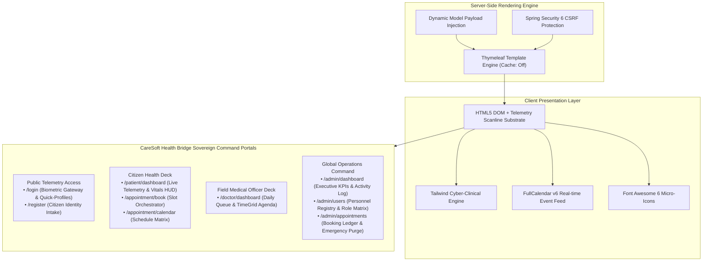

# 🎨 CareSoft Health Bridge: UNESCO Global Health Logistics — Frontend Tier Workflow

This document details the modern cyber-clinical UI design system, component hierarchy, state handling, and view flows for the frontend presentation tier of **CareSoft Health Bridge: UNESCO Global Health Logistics**.

---

## 1. Architectural Overview

The frontend presentation tier delivers a high-tech, responsive clinical command experience powered by **Spring Boot & Thymeleaf** with modern **Tailwind CSS**, interactive temporal grids via **FullCalendar.js v6**, and telemetry iconography via **Font Awesome 6**.



---

## 2. Cyber-Clinical Design System & Color Psychology

Healthcare logistics demands sterility, clarity, and rapid triage capability:

* **Void Black Substrate (`#030712`)**: High-contrast, glare-reducing clinical backdrop minimizing eye fatigue.
* **Clinical Surface (`#0b1329` / `#0f172a`)**: Frosted cryo-glass cards (`backdrop-blur-xl`) with sub-pixel glowing borders (`rgba(0, 240, 255, 0.15)`).
* **Cryo-Teal (`#0d9488` / `#14b8a6`)**: Signifies medical safety, trust, and verified clinical protocols.
* **Bio-Luminescent Cyan (`#00f0ff`)**: Digital telemetry accent for active connections, scheduled appointments, and pulse beacons.
* **Status Triage Flags**:
  - 🟢 **Nominal / Completed**: `#10b981`
  - 🟡 **Scheduled / In-Queue**: `#00f0ff` / `#38bdf8`
  - 🔴 **Emergency / Triage Alert**: `#ef4444`

---

## 3. Component Architecture & View Matrix

| Template Path | View Endpoint | Audience | Key UI/UX Upgrades |
| :--- | :--- | :--- | :--- |
| [`login.html`](file:///D:/PROJECT_S/Spring%20Boot%20HMS/hospital-management-springboot/src/main/resources/templates/login.html) | `/login`, `/` | Public | Bio-luminescent split-screen terminal, quick sign-in profile pills (Admin, Doctor, Patient), TLS 1.3 indicator |
| [`register.html`](file:///D:/PROJECT_S/Spring%20Boot%20HMS/hospital-management-springboot/src/main/resources/templates/register.html) | `/register` | Citizens | Sovereign Health Identity intake, organized 2-column demographic grid, client-side validation |
| [`patient/dashboard.html`](file:///D:/PROJECT_S/Spring%20Boot%20HMS/hospital-management-springboot/src/main/resources/templates/patient/dashboard.html) | `/patient/dashboard` | `ROLE_PATIENT` | Citizen ID barcode card, upcoming consultation metrics, custom FullCalendar dark theme with live `/appointment/events` stream |
| [`appointment/book.html`](file:///D:/PROJECT_S/Spring%20Boot%20HMS/hospital-management-springboot/src/main/resources/templates/appointment/book.html) | `/appointment/book` | `ROLE_PATIENT` | Certified medical officer dropdown, date/time slot selectors, protocol terms card, tactile confirmation |
| [`appointment/calendar.html`](file:///D:/PROJECT_S/Spring%20Boot%20HMS/hospital-management-springboot/src/main/resources/templates/appointment/calendar.html) | `/appointment/calendar` | `ROLE_PATIENT` | Full-screen interactive schedule matrix, monthly/weekly view toggles, quick booking CTAs |
| [`doctor/dashboard.html`](file:///D:/PROJECT_S/Spring%20Boot%20HMS/hospital-management-springboot/src/main/resources/templates/doctor/dashboard.html) | `/doctor/dashboard` | `ROLE_DOCTOR` | Field Medical Officer HUD, today's clinical queue cards, live FullCalendar `timeGridWeek` with current-time indicator |
| [`admin/dashboard.html`](file:///D:/PROJECT_S/Spring%20Boot%20HMS/hospital-management-springboot/src/main/resources/templates/admin/dashboard.html) | `/admin/dashboard` | `ROLE_ADMIN` | Global telemetry cards (Total Accounts, Citizens, Doctors, Bookings), recent consultations activity ledger |
| [`admin/users.html`](file:///D:/PROJECT_S/Spring%20Boot%20HMS/hospital-management-springboot/src/main/resources/templates/admin/users.html) | `/admin/users` | `ROLE_ADMIN` | Global personnel registry, inline authority modification dropdowns, secure record purge with confirmation |
| [`admin/appointments.html`](file:///D:/PROJECT_S/Spring%20Boot%20HMS/hospital-management-springboot/src/main/resources/templates/admin/appointments.html) | `/admin/appointments` | `ROLE_ADMIN` | Comprehensive booking ledger, start telemetry formatting, emergency purge triggers |

---

## 4. FullCalendar Cyber-Clinical Theming

Both Doctor and Patient views leverage custom FullCalendar v6 CSS variables tailored to the dark glassmorphic palette:

```css
.fc {
    --fc-border-color: rgba(51, 65, 85, 0.6);
    --fc-page-bg-color: transparent;
    --fc-neutral-bg-color: rgba(15, 23, 42, 0.7);
    --fc-today-bg-color: rgba(13, 148, 136, 0.15);
    font-family: 'Plus Jakarta Sans', sans-serif;
    color: #cbd5e1;
}
.fc-event {
    border-radius: 8px !important;
    border: 1px solid rgba(0, 240, 255, 0.3) !important;
    background: linear-gradient(135deg, rgba(13, 148, 136, 0.9), rgba(15, 118, 110, 0.9)) !important;
    box-shadow: 0 4px 12px rgba(0, 0, 0, 0.3);
}
```

---

## 5. Security Micro-Engine & Navigation Guards (`caresoft-security-guard.js`)

The frontend integrates a dedicated client-side security engine ([`caresoft-security-guard.js`](file:///D:/PROJECT_S/Spring%20Boot%20HMS/hospital-management-springboot/src/main/resources/static/js/caresoft-security-guard.js)) providing complete security interoperability with Spring Security 6:

### 5.1 Dynamic CSRF Management via `X-CSRF-TOKEN`
* **Meta-Tag Extraction**: On page load, the engine extracts the session token from `<meta name="_csrf">` and `<meta name="_csrf_header">`.
* **Fetch API Interceptor**: Automatically patches `window.fetch` to attach the `X-CSRF-TOKEN` HTTP request header to all mutating operations (`POST`, `PUT`, `DELETE`, `PATCH`), completely eliminating legacy `<input type="hidden" name="_csrf">` boilerplate.
* **Token Rotation Handling**: Automatically synchronizes new tokens issued by Spring Security's `CsrfAuthenticationStrategy` after authentication.

### 5.2 Role-Based Client Navigation Guards
* **Role Telemetry**: Captures user role from the DOM (`data-user-role="ADMIN | DOCTOR | PATIENT"`).
* **Preemptive Boundary Enforcement**: Intercepts unauthorized navigation attempts (e.g. a `PATIENT` attempting to access `/doctor/*` or `/admin/*`).
* **Visual HUD Alert & Re-routing**: Displays a glassmorphic cyber-clinical alert toast ("ACCESS VIOLATION: Clearance Required") and safely delegates to `/dashboard`, replicating the Spring Security smart router.

### 5.3 Unified Session Termination
* **`CareSoftSecurity.logout()`**: Programmatically executes `POST /logout` with the valid `X-CSRF-TOKEN` header and `credentials: 'include'`.
* **Graceful Lifecycle**: Flushes client-side telemetry state and redirects cleanly to `/login?logout`.
